# Hey, I’m James 👋

Junior at Georgia Tech pursuing a **B.S. in Mathematics** with a concentration in **Data Science**. I have 1.5+ years of internship experience in data engineering, REST API development, and analytics. Currently building a stock confidence rating pipeline.

---

### Technical Skills

**Languages:** Python, SQL, Java, Go

**Data Engineering & ML:** Dagster, DuckDB, PostgreSQL, Databricks, XGBoost, Pandas, Tableau

**Cloud, Infra & APIs:** AWS (EC2, S3, Route 53), Oracle Cloud (OCI), Terraform, RESTful APIs, Git, Docker

---

